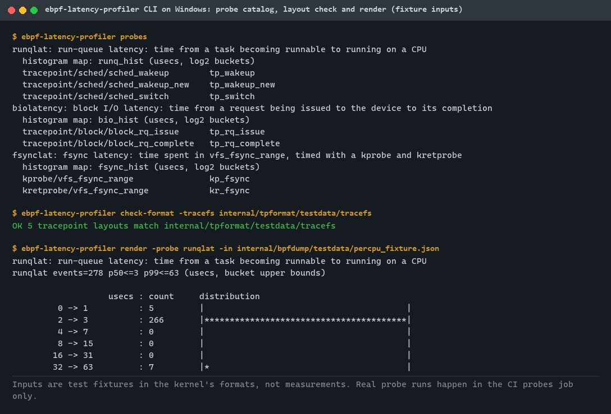
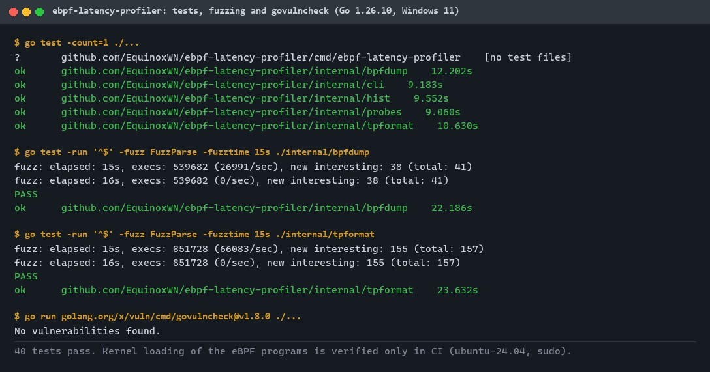
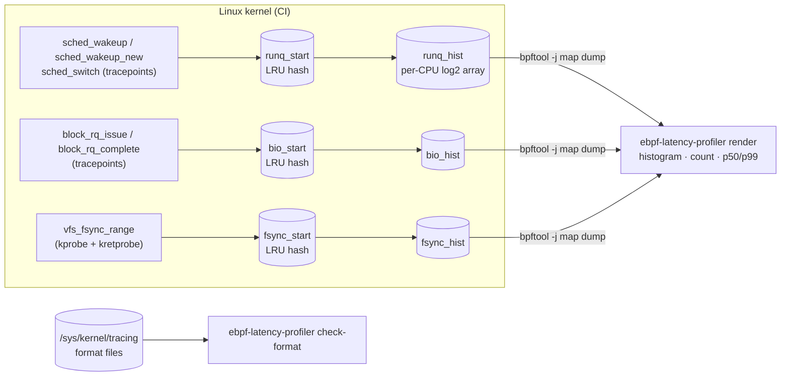
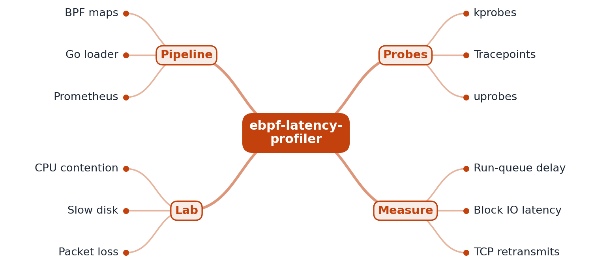
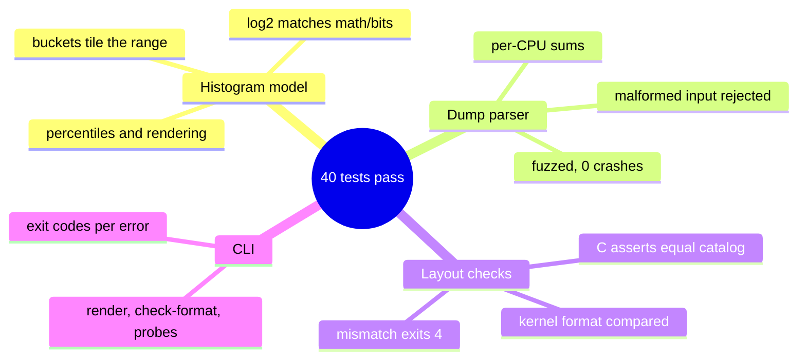

# ebpf-latency-profiler

[](https://github.com/EquinoxWN/ebpf-latency-profiler/actions/workflows/ci.yml)


> Find where latency hides in the kernel (run-queue waits, slow disk requests, slow fsync) without changing a line of app code.

Part of my **DevOps and Cloud** list · C · Go

## Proof it works

The CLI lists the probes and the attach points they use, checks the tracepoint layouts the programs
assume, and renders a histogram from a `bpftool` map dump. The inputs here are test fixtures in the
kernel's formats, because the author's machine runs Windows:



40 Go tests pass, both input parsers survive fuzzing, and govulncheck finds no vulnerabilities in
called code with Go 1.26.10, the version CI uses:



**The eBPF programs are compiled, loaded and attached only in CI** (the `probes` job on
ubuntu-24.04 with sudo). Each run prints the event count and p50/p99 bucket bounds per probe as a
`::notice` annotation. They have not been run on the author's machine.

## Architecture

**What M1 runs today:**



**Full roadmap (M1 to M3):**



## How it works

_Steps 1 and 2 are built and tested (M1, kernel runs in CI only); the rest is on the [roadmap](#roadmap)._

1. Small eBPF programs attach to kernel tracepoints and kprobes to time events such as a thread waiting to run or a disk request finishing. M1 has three probes: run-queue delay (`sched_wakeup`, `sched_wakeup_new`, `sched_switch`), block I/O latency (`block_rq_issue` to `block_rq_complete`) and fsync latency (kprobe and kretprobe on `vfs_fsync_range`).
2. Latency histograms are built inside the kernel in BPF maps, keeping overhead low. Each end event adds one count to a per-CPU log2 bucket (microseconds), so user space reads 32 counters per CPU instead of every event. Start times live in LRU hash maps capped at 10,240 entries.
3. A Go program using cilium/ebpf loads them (CO-RE, so one binary works across kernels) and exports to Prometheus.
4. uprobes on a sample service link kernel delays to specific requests.
5. A lab injects CPU contention, a slow disk and packet loss, and the tool pinpoints each cause.
6. Results are cross-checked against established bcc tools such as runqlat and biolatency.

Tracepoint records are read by fixed offsets, so the layout is pinned three times: `_Static_assert`
in the C program, a Go test that ties those asserts to the Go catalog, and `check-format`, which
compares the catalog with the running kernel's tracefs before anything is loaded.

## Who it helps

- **Who:** engineers who debug latency on Linux hosts, and people learning how eBPF latency tools such as bcc's `runqlat` and `biolatency` work inside.
- **The problem:** application metrics show that p99 went up but not why; the wait is often in the kernel (a runnable thread without a CPU, a queued disk request, a slow fsync), which those metrics cannot see.
- **How to use it:** compile `bpf/latency.bpf.c`, load it with `bpftool` (see [Run it](#run-it)), let the workload run, then dump a histogram map and pipe it into `ebpf-latency-profiler render`. Run `check-format` first on a new kernel to confirm the tracepoint layouts match.
- **What it is not yet:** a single binary that loads itself, or a Prometheus exporter (both M2).

## Tech stack

| Area | In M1 | Planned |
|---|---|---|
| Kernel | eBPF in C (libbpf headers), classic tracepoints, kprobe/kretprobe, LRU hash and per-CPU array maps | CO-RE with BTF, uprobes, TCP retransmits |
| Loader | bpftool (`prog loadall … autoattach`, ADR 0002) | Go loader with cilium/ebpf (M2) |
| User space | Go standard library: dump parser, tracefs format checker, bcc-style histogram output | Prometheus exporter (M2) |
| Test | Go unit, property and fuzz tests; CI job that loads the probes on a real kernel | Fault-injection lab, comparison with bcc (M3) |

Language: **C · Go** (standard library only).

| Path | What it is |
|---|---|
| `bpf/latency.bpf.c` | The eBPF programs and maps |
| `internal/hist` | Log2 histogram model (mirrors the kernel bucketing), percentiles, rendering |
| `internal/bpfdump` | Parser for `bpftool -j map dump` of per-CPU and plain arrays |
| `internal/tpformat` | Parser for tracefs `format` files and layout checks |
| `internal/probes` | Probe catalog: attach points, maps, expected tracepoint layouts |
| `internal/cli`, `cmd/ebpf-latency-profiler` | Command line: `probes`, `check-format`, `render` |
| `scripts/probe-run.sh` | Linux, root: load, attach, run workloads, dump and render (used by CI) |

## Run it

Go side (any OS, Go 1.23+; CI uses 1.26.10):

```bash
make lint    # gofmt, go vet (host and linux)
make test    # all Go tests
make fuzz    # 30 s of fuzzing per parser
make audit   # govulncheck
make build   # bin/ebpf-latency-profiler
```

Kernel side (Linux, root, clang, libbpf headers and bpftool v7+, for example on Ubuntu 24.04:
`sudo apt-get install clang llvm libbpf-dev linux-tools-$(uname -r)`):

```bash
make bpf            # bin/latency.bpf.o
make check-format   # tracepoint layouts vs. the running kernel
make probe-run      # load, attach, run the sample workloads, print the three histograms

# or by hand, against your own workload:
sudo bpftool prog loadall bin/latency.bpf.o /sys/fs/bpf/elp/progs pinmaps /sys/fs/bpf/elp/maps autoattach
# ... let the workload run ...
sudo bpftool -j map dump pinned /sys/fs/bpf/elp/maps/runq_hist | ./bin/ebpf-latency-profiler render -probe runqlat
sudo rm -rf /sys/fs/bpf/elp   # detach and free everything
```

Environment: `BPFTOOL` (bpftool binary for `make probe-run` and `scripts/probe-run.sh`, default `bpftool`) and `BPF_CLANG` (`make bpf` compiler, default `clang`).

`render` flags: `-probe runqlat|biolatency|fsynclat`, `-in FILE` (default stdin), `-format text|line|json`,
`-min-count N` (exit 3 if fewer events).

## Tests and results

40 tests, 0 failures (Go 1.26.10, Windows 11). Full table with every test: [docs/results/m1.md](docs/results/m1.md).
Quality check of the 10 engineering rules, with a mutation test of the core functions: [docs/quality/2026-11-01.md](docs/quality/2026-11-01.md).

| File | Tests | What it proves |
|---|---|---|
| `internal/hist/hist_test.go` | 11 | The Go port of the kernel's branch-free log2 matches `math/bits` on 100,014 values; buckets tile the range; percentiles, merge (including overflow) and bcc-style rendering are correct |
| `internal/bpfdump/dump_test.go` | 9 | bpftool JSON dumps (per-CPU and plain) are summed correctly; malformed, oversized, overflowing and too-many-CPU input is rejected; round trip on 1 to 64 CPUs; fuzz seed corpus |
| `internal/tpformat/format_test.go` | 7 | tracefs format files parse (arrays, `__data_loc`); moved, resized and missing fields are reported; malformed files rejected; fuzz seed corpus |
| `internal/probes/catalog_test.go` | 7 | The Go catalog and `latency.bpf.c` agree on every `SEC()`, map, `MAX_SLOTS` and `FIELD_ASSERT` offset; layout changes are detected |
| `internal/cli/cli_test.go` | 6 | `render`, `check-format` and `probes` end to end, including exit codes for every error path |

Headline results:

- Fuzzing (re-run 2026-11-01): 539,682 dump-parser inputs and 851,728 format-parser inputs in 15 s each, 0 crashes.
- `go vet` (windows and linux), `gofmt`: clean. govulncheck v1.8.0: no vulnerabilities in called code.
- Kernel side: compiled, layout-checked, loaded and run **in CI only**; per-probe event counts and
  p50/p99 bucket bounds are in the CI run's `::notice` annotations. Overhead is not measured yet (M3).



## Roadmap

**M1** (≈8 h)
- [x] Write `docs/rfc/0001-design.md`: problem, goals, non-goals, chosen design
- [x] Small eBPF programs attach to kernel tracepoints and kprobes to time events such as a thread waiting to run or a disk request finishing.
- [x] Latency histograms are built inside the kernel in BPF maps, keeping overhead low.

**M2** (≈8 h)
- [ ] A Go program using cilium/ebpf loads them (CO-RE, so one binary works across kernels) and exports to Prometheus.
- [ ] uprobes on a sample service link kernel delays to specific requests.

**M3** (≈9 h)
- [ ] A lab injects CPU contention, a slow disk and packet loss, and the tool pinpoints each cause.
- [ ] Results are cross-checked against established bcc tools such as runqlat and biolatency.
- [ ] Publish the proof below with real numbers

## Proof

What this repo must show before it counts as done:

- Three lab scenarios where the tool finds the root cause, verified against bcc tools.

| Result | Value |
|---|---|
| M3 proof above | Not measured yet (M3). Current M1 results: see [Tests and results](#tests-and-results). |

## Why it matters

- **Interview angle:** 'p99 latency spiked but CPU looks fine: how do you investigate?'
- **Upstream I'd like to contribute to:** cilium/ebpf, bcc or bpftrace: tools, docs or fixes.

## Design docs

- [RFC 0001: design](docs/rfc/0001-design.md)
- [ADR 0001: record architecture decisions](docs/adr/0001-record-architecture-decisions.md)
- [ADR 0002: load probes with bpftool in M1, cilium/ebpf in M2](docs/adr/0002-bpftool-loader-before-cilium-ebpf.md)
- [M1 results](docs/results/m1.md)

## Scope

This is a learning and portfolio system, not a hosted production service. The Go side runs anywhere;
the eBPF programs need Linux and root, and are exercised in CI.

## Security and contributing

- Every GitHub Action is pinned to a commit SHA; workflows run read-only, without persisted credentials.
- Dependabot update pull requests are paused (`open-pull-requests-limit: 0`) so the repository keeps a single `main` branch; dependencies are updated by hand and checked by the CI audit.
- Parsers bound their input (16 MiB dumps, 1 MiB format files) and are fuzzed. The kernel maps are size-capped.
- Loading eBPF programs needs root: read `bpf/latency.bpf.c` before you load it.
- Report vulnerabilities privately: see [SECURITY.md](SECURITY.md). To contribute, see [CONTRIBUTING.md](CONTRIBUTING.md).

## License

MIT, see [LICENSE](LICENSE). The eBPF program in `bpf/` declares GPL-2.0 (SPDX header and `license` section), the usual choice for code loaded into the kernel.
